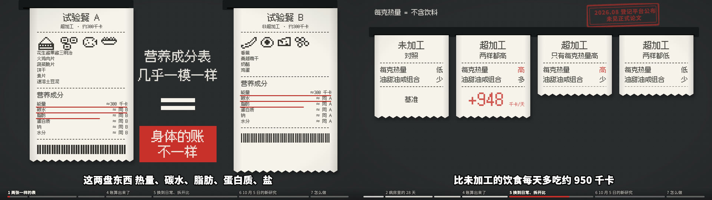

# 热敏小票(id: thermal)

## 渲染语言
超市收银台的热敏小票:米白热敏纸条(#F6F3EC)上,打印头打出的**点阵字**(黑 #1D1C1A),双色热敏纸的**红**(#C8312B)只给少数几处。
纸条两侧微微卷起(左右边一道淡阴影),底边是撕口锯齿;条码、虚线分隔、「×1」「≈」这类小票符号是现成的版面语言。
**比喻是「账」**:打印机打出来的是机器记下的账(清单、数字、读数);人在小票上用圆珠笔写、用红笔圈、盖红章。适合「同样的东西,账算出来不一样」这类题。
**颜色即含义**:红只给「身体的账 / 要警惕的量 / 印章」,其余一切是黑。红一多就失去意义。
画风默认是**浅色台面**(#D9D3C6,底子与小票同一明暗,通用组件放哪都看得清)。**深色收银台**(#2A2B2E,`c.desk`)是场景的选择:页面自己铺,台面上的字传 `fill: c.paper`(第 13 期这么用)。

## 材质与后期
- 墨迹斑驳:组件上的字统一套 `vc-thermal`(分形噪声扣掉一点墨,像热敏头没压匀);**纸面不进滤镜**,只给墨(第 13 期静帧:整张纸进滤镜会被压成灰色)。
- 纸条:`kit.panel(x, y, w, h, 标题)` 出一张小票(投影 + 两侧卷边阴影 + 底边锯齿 + 居中标题 + 虚线)。
- 台面:浅色或深色细格纹(6px),`backdrop: 'counter'`。
- 1 位像素小图:小票上的图标用逐像素方块拼(热敏打印机只会打黑点),比例 7px / 格左右。
- **小票部件在附加模块 `engine/vc/receipt.js`**(第 13 期整片抽出):`const rc = VC.receipt(kit)` → `rc.build` 边打边长的小票(行函数 `rc.hd / ln / row2 / ctr / dashed`)、`rc.slot` 出纸口、`rc.sprite / sprites` 像素图(图库 `VC.receipt.SPRITES`)、`rc.barcode`、`rc.dotCurve / dotScatter / dotBar` 点阵图、`rc.feed` 走纸转场。用法见 `engine/vc/README.md`「小票」三行。抽出来后第 13 期页面改用它:抽查 128 帧里,转场以外 126 帧逐字节相同(另 2 帧是下面说的转场修正),音效表 278 条相同(阳性对照:改纸条阴影后 110 帧不同)。

## 字体倾向
- **打印机打的**(R1–R4、R10):**缝合像素 Fusion Pixel 12px**。点阵字**字号只能是 12 的整数倍**(24 / 36 / 48 / 72 / 96 / 144),否则笔画落在半像素上会糊 —— 画风写了 `pixel: 12`,`kit.text` / `kit.fit` 自动吸附,`fit` 缩字号也是一档 12 一档 12 地缩。
- **人写的**:圆珠笔手记 R8 = 小赖(蓝 #24324C);红笔圈改 R6 = 志莽行书(红)。
- **盖的**:印章 R9 = 思源黑体 900 红。
- **复印件上的原文** R5 = 思源宋体 500(期刊、新闻稿不是小票打的)。
- 字幕与章节进度条按频道配置,不跟画风走。

## 组件长什么样
- 面板(`panel: 'receipt'`):小票纸条,标题点阵字居中 + 一条虚线。窗口(对话框、终端)用 `bezel`(一台深色机器)。
- 文字出场 `print`:**一行字从上往下逐像素行扫出**(打印头走纸),匀速、不缓动;默认每行 0.3s(R1 0.35s、R3/R10 0.2s,`printDur`)。多行 `textFit` 会一行接一行打。
- 印章 `ink`(红,油墨斑驳落下一震);批注 `pencil`(红笔圈,正片叠底);数字 `print`;气泡 `note`(纸条 + 胶带,圆珠笔字)。
- 占位角色:红色身子 + 墨线。

## 动效手感
- 小票是**打出来的**:新内容出现 = 打印机吐纸(纸条往下长一截,字逐行扫出),不要淡入。
- 纸条可以撕、卷、叠放、翻面(背面就是另一张账,如配料表);印章落下震一下。
- 转场:**走纸** `rc.feed`(镜头往下摇:旧画面往上出画、新出纸口从下面上来,整片用的就是它);撕下(旧纸条沿锯齿撕走)会斜扫过字幕带,只在没有字幕的时候用。

## 人物怎么画
- 代码画:1 位像素图标(热敏打印机能打的就是黑点);占位角色红身墨线。
- 生图角色:要求「1-bit thermal print, black dots on off-white receipt paper, no gray」,再在代码里压成两色。
- 代码补光:不补光;深浅只用点的疏密(抖动网格)。

## 能画的场景
整片 ×1(第 13 期,2026-10-10,6 分 22 秒横版):深色收银台 + 小票。住院登记单、日结小票、四条对比小票、配料表(示意)、点阵曲线 / 散点(带「示意」标注)都是小票;决策者看过,通过。
建议:账单 / 清单 / 对比类题目(热量、价格、时间账);实验记录逐日打出;「表面一样、算下来不一样」的反转。

## 样张(2026-10-10)
[空场景](samples/thermal-1-scene.jpg) · [文字角色 R1–R10](samples/thermal-2-roles.jpg) · [角色](samples/thermal-3-character.jpg)。重出:`node engine/vc/samples.mjs thermal`。

成片截图(第 13 期,片头 + 四条对比小票):

## 踩坑
- **字体族名要加引号**:`Fusion Pixel 12` 里有以数字开头的词,不加引号整条 `font-family` 作废,浏览器静默换成默认黑体 —— 入库第一版样张整张都是黑体,检查全绿。已在 `vc.js` 的 `fontAttr` 统一加引号(同一个 bug 也让黑板粉笔、白板手绘的 `Jason Handwriting 1` 从入库起就没生效,2026-10-10 一并修好)。`VC.ready` 现在会比对画出来的宽度和这个字体应有的宽度,对不上就判「没用上」、渲染器拒绝开工(反向对照:去掉引号后抓出 3 处)。
- 画风默认深色台面时,通用组件的字(墨色)压在深色台面上看不见;所以画风默认浅色台面,深色台面交给场景。
- 压测页的出画阳性对照(`fit-test.html?&bad`)在本画风上不报:R1 只有 72px,最长那句恰好没出画。要证明检查有效,把 `&bad` 的字号临时提到 96 再跑(7 处出画,2026-10-10)。

## 整片里学到的(第 13 期)
- **小票上的字分三级**:标题 48、正文 36、注释 24(都是 12 的倍数)。正文别低于 36,频道规矩是关键字 ≥ 28px,24 只给注释与单位。
- **小票最容易「抄字幕」**:清单天然一行一句,写着写着就把旁白原句打上去了(初版验收 43 秒画面复述)。改成账单式短标签(「顺序:随机」「每克热量 = 不含饮料」「长期影响:未知」),意思不变、事实行不变,降到 0。
- **「撕下」转场会扫过字幕带**:撕口斜着划过底部(初版 17 帧压字幕)。换镜改用竖向推走(镜头往下摇:旧小票往上出画、新的出纸口从下面上来,不经过字幕区),更像走纸;已收进 `receipt.js`(`rc.feed`)。
- **几张小票同屏横移时 `clipPath` 的 id 会撞**:页面自己的小票函数要像 `kit.begin()` 一样,每帧把自己的计数器归零,否则 `print` 扫字裁到别的小票上(`rc.build` 已经这么做)。
- **红章旋转后按外接框量边**:章内字要离内框留够余量(-3° 时高度至少 100)。
- **走纸转场的台面只铺新画面那一屏**:新画面下面垫的台面要是往外多铺了几屏(防露边),就会把正往上走的旧画面整个盖掉,0.9 秒里只剩空台面(第 13 期成片三处转场都是这样,抽进 `receipt.js` 时复核抓出;`rc.feed` 已裁好)。
- **示意图要在画面上写「示意」**:点阵曲线、散点是按论文文字描述的走向画的,不是读数;配料表是示意,不是真实产品。
